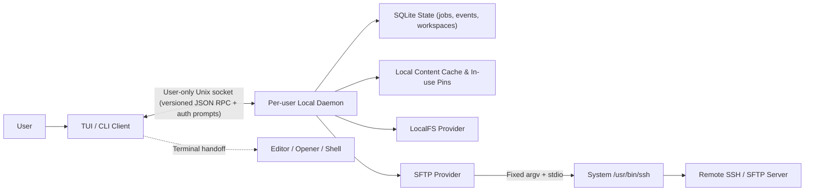
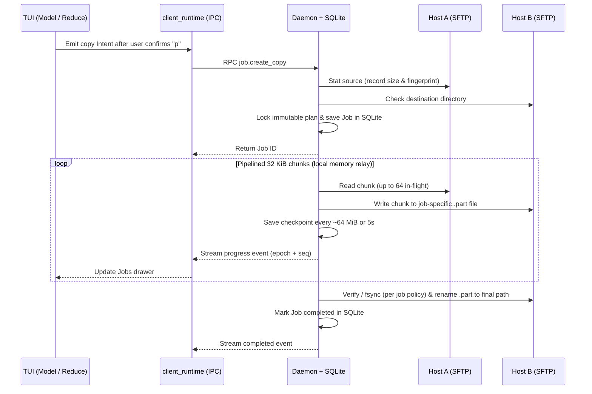

# Technical Design and Architecture

[简体中文](../zh-CN/architecture/design.md)

AMSFTP is a two-pane terminal file manager for local directories and SFTP
servers. Either pane can point to the local filesystem or to an SSH host from
`~/.ssh/config`, so local-to-local, local-to-remote, and remote-to-remote
operations share one interface and one transfer engine.

This document explains how AMSFTP is built, how a real user action flows from
the terminal to a remote server and back, and where its security and
reliability boundaries sit.

## 1. Problems that shape the design

A simple file browser can live inside a single terminal process. A reliable
SFTP transfer tool has five harder constraints:

1. **Real-world SSH is messy:** Users rely on `~/.ssh/config`, `Include`,
   `Match`, `ProxyJump`, `ProxyCommand`, SSH agents, security keys, MFA
   prompts, and Kerberos/GSSAPI. Re-implementing SSH in Go would constantly lag
   behind OpenSSH and force users to duplicate credentials.
2. **Transfers must outlive the terminal:** Closing a laptop lid, detaching
   tmux, or quitting the TUI must not kill a 10 GiB upload or leave its state
   unknown.
3. **Partial files must never look finished:** A network drop halfway through a
   copy cannot leave a truncated file sitting at the final path, and a move
   cannot delete the source before the destination is safely in place.
4. **Remote servers are untrusted input:** Authenticating a host proves who
   answered, not that filenames, metadata, or error text are safe to print to a
   terminal or pass to a shell.
5. **Large trees must not blow up memory:** Directory listings, previews,
   searches, transfer buffers, logs, and queues all need hard limits so a huge
   remote tree degrades gracefully instead of running the client out of memory.

Every major boundary in AMSFTP comes directly from these five constraints.

## 2. Process model and system topology

AMSFTP ships as a single binary (`cmd/amsftp`) with two runtime roles:

- **Short-lived client (TUI or CLI):** Owns the terminal—keyboard input,
  rendering, confirmation dialogs, and temporarily handing the terminal to an
  editor or shell. It never writes directly to a remote server.
- **Per-user local daemon:** Owns long-lived SSH/SFTP connections, background
  transfer jobs, SQLite job/workspace state, and the local file cache. It runs
  strictly as the current OS user—never as `root`, never on a TCP port.

### Client–daemon IPC

Client and daemon talk over a Unix domain socket accessible only by your user
(`0600` inside a `0700` directory):

- **Identity check:** Both ends verify the OS peer UID (`SO_PEERCRED` on Linux,
  `LOCAL_PEERCRED` on macOS) before accepting any request.
- **Versioned framing:** Handshake negotiates protocol version and features;
  JSON messages enforce a size limit (8 MiB default) and request timeouts.
- **Restart-safe event streams:** Each daemon startup creates a unique session
  ID (epoch), and streamed events carry monotonically increasing numbers. If
  the daemon restarts, clients detect the new startup ID, reconnect panes
  cleanly, and ignore late events from the old process.

Separating the terminal UI from the daemon means quitting the TUI (`q`) simply
detaches the client while transfers keep running—and crash recovery always has
one owner.

### How interactive SSH prompts reach the terminal

Because the daemon spawns `/usr/bin/ssh` while the TUI owns the terminal, an
in-memory auth broker (`internal/auth`) bridges interactive password or MFA
prompts without ever touching disk:

1. `/usr/bin/ssh` invokes AMSFTP's internal `SSH_ASKPASS` helper, which asks
   the daemon's auth broker for an answer.
2. If a TUI client is attached, the daemon sends the prompt over IPC; the TUI
   collects the answer in memory and returns it over IPC.
3. The daemon forwards the answer to OpenSSH and clears it from memory. If no
   TUI client is attached, the background job pauses in `waiting_auth` rather
   than guessing or storing credentials.

## 3. Endpoints, providers, and OpenSSH delegation

### Endpoints and locations

An **Endpoint** identifies a filesystem boundary (`local` or a named SSH host
alias). A **Location** pairs an Endpoint with an absolute path, so `/srv/app`
on `host-a` and `/srv/app` on `host-b` are never confused.

### Minimal provider contract

Both local files and remote SFTP hosts sit behind one `Provider` interface
(`internal/provider`):

- **Read-only core (6 methods):** `Descriptor`, `Snapshot`, `Normalize`,
  `List`, `Stat`, and `OpenRead`.
- **Optional write interfaces (checked at runtime):** Writing, safe backup
  before overwrite, and trash deletion are split into separate Go interfaces
  (`MutableProvider`, `DestinationPreserver`, `TrashProvider`). Write paths
  require both the Go interface *and* a per-connection capability record
  proving the current server supports the needed SFTP extensions (such as
  atomic rename or `fsync`).
- **Optional streaming read interface:** `ReadAheadHandle` enables pipelined
  reads on high-latency SFTP links; callers fall back to plain `Read` if
  absent.

Every new connection builds a fresh capability record. If a server reconnects
with different extensions, AMSFTP refreshes the record instead of assuming old
features still exist.

### Why OpenSSH stays the SSH authority

The SFTP provider launches the validated system `/usr/bin/ssh` with fixed,
structured arguments (disabling port/agent forwarding and shell expansion) and
speaks the SFTP binary protocol directly over stdin/stdout. It does **not**
scrape interactive `sftp` text output, and it never passes host aliases through
a shell.

Because OpenSSH remains in charge, `~/.ssh/config`, host-key verification,
`known_hosts`, SSH agents, hardware keys, `ProxyJump`, and Kerberos/GSSAPI work
identically to running `/usr/bin/ssh <alias>`. AMSFTP intentionally has no
second SSH library and no credential database.

### Standard SFTP baseline vs. optional enhancements

Standard SFTP is the universal baseline. Remote-to-remote copies stream through
a small memory relay inside the local daemon—reading chunks from host A and
writing chunks to host B without storing the full file on local disk or copying
SSH credentials to either server.

The codebase also reserves isolated extension interfaces for an optional remote
helper (`internal/helper`) and direct server-to-server transfer
(`internal/directprotocol`). Both are **disabled in public builds** by design
and cannot be unlocked via config; if an optional path is unavailable, routing
stays on standard SFTP.

## 4. Transfer engine: plan, execute, verify, recover

Whether triggered from the TUI or CLI, every copy, move, rename, or delete
passes through the daemon's transfer engine. Here is how a remote-to-remote
copy travels end to end:

### Locking in an immutable plan

Before transferring a byte, the daemon inspects source and destination and
saves an immutable plan in SQLite: exact source/destination locations, observed
fingerprints, transfer route, conflict policy, verification mode, and sync
policy. Workers execute only that saved plan. If a file changes materially
underneath, the job pauses for a conflict decision rather than silently
improvising during a retry.

### Pipelined streaming and concurrency

- **Single file:** Standard SFTP keeps up to 64 concurrent 32 KiB read/write
  requests in flight per file, saturating high-latency links without buffering
  entire files in RAM.
- **Directory copies:** Share a pool of 128 concurrent data requests across up
  to 8 files at once. Small files claim only the slots their size needs; parent
  directories are always created before their children; symlinks are never
  followed.
- **Periodic checkpoints:** Progress checkpoints are saved roughly every 64 MiB
  or 5 seconds (storing acknowledged offset, running source SHA-256 state, and
  temporary file identity) instead of stalling every packet on disk sync.
- **Rate limiting:** Optional global, per-endpoint, and per-job byte-rate
  limits meter file data reads/writes cleanly and remain interruptible by pause
  or cancel.

### Verification vs. durability trade-offs

Completion checks and disk synchronization are separate choices so regular
copies stay fast while moves and edits stay conservative:

| Mode | What it checks | Extra I/O cost |
| --- | --- | --- |
| **Default copy** (`protocol` + `none`) | All SFTP writes acknowledged, exact byte count, clean close, temp-to-final rename succeeds | Minimal (comparable to native `sftp`, plus temp-file safety) |
| **Strict hash** (`verification: "sha256"`) | Reads back and hashes temp file and final file against source SHA-256 | +2× read I/O on uploads |
| **Completion sync** (`durability: "completion"`) | Calls `fsync` once before closing/renaming (comparable to `sftp put -f`) | 1 `fsync` RTT per file |
| **Moves & edit uploads** | Always keep SHA-256 verification and synced checkpoints | Higher I/O for maximum data safety |

**Honest protocol limits:** SSH encryption protects bytes in flight, not stored
content on disk. A successful `fsync` is evidence about file data, not a
guarantee of honest storage hardware. On SFTP servers without atomic
compare-and-swap rename extensions, a concurrent third-party writer can still
race between check and rename—AMSFTP detects unexpected changes when verifying,
but cannot turn SFTP into a distributed transaction manager.

### Error model and crash recovery

Every internal error is classified into a `domain.OpError` carrying three
pieces of information:

- **`Code`:** stable category (`conflict`, `auth_required`,
  `transport_interrupted`, `resource_exhausted`, etc.).
- **`Retry`:** explicit advice (`never`, `backoff`, `after_reconnect`,
  `after_auth`, `after_conflict`, `after_replan`).
- **`Effect`:** whether the operation had a side effect (`none`, `applied`, or
  `unknown`).

Tracking `Effect` prevents blind retries on non-idempotent operations. On
restart or resume:

1. **Partial files:** Because checkpoints save every ~64 MiB or 5 seconds, a
   crash can leave unrecorded trailing bytes past the last saved offset. On
   resume, AMSFTP hashes the saved prefix of the temporary file against the
   recorded source digest even if size and mtime still match, and verifies any
   trailing bytes against the unchanged source before truncating back.
   Unprovable or altered files trigger a conflict instead of silent append or
   truncation.
2. **Lost rename responses:** If the connection drops right at final rename,
   AMSFTP requires full content verification before declaring success—even in
   default protocol mode.
3. **Moves:** The source is deleted only after the destination is verified and
   renamed into place. If source deletion cannot be proved, AMSFTP keeps the
   source and completes the job as *source retained*.

## 5. Interactive layer: TUI, preview, editing, and search

### Pure Model/Reducer TUI

`internal/tui` follows an Elm-style pure architecture:

- `Model` is plain data; `Reduce(Model, Action) -> (Model, []Intent)` is a pure
  state transition function; `Render` draws onto an in-memory surface.
- `internal/tui` performs **zero I/O** (no files, no sockets, no subprocesses).
- `internal/app/client_runtime.go` interprets emitted `Intent`s by calling the
  daemon over RPC asynchronously and feeding results back as `Action`s.
- Every pane listing, preview, and search request carries an incrementing
  request version number (generation ID) so late responses from an earlier
  directory or query are silently dropped.
- Rendering computes only the visible terminal rows rather than laying out
  every loaded entry.

### Preview and local content cache

- **Preview (`internal/preview`):** Reads only small byte ranges (never whole
  large files), escapes control characters to prevent terminal injection,
  displays symlinks as metadata, and emits terminal image bytes only after
  actively probing image-protocol support.
- **Content cache (`internal/cache`, `internal/cachefs`, `internal/cachemanager`):**
  Stores downloaded preview/edit copies in a SHA-256 content-addressed private
  store separate from transfer `.part` files and job state. Quotas default to
  2 GiB global / 1 GiB per workspace. Active previews, editors, openers, and
  pending recoveries hold in-use pins (cache leases) so live files are never
  cleaned up underneath another program.

### Safe remote editing

Editing a remote file (`e`) or opening it in a desktop app (`o`) never treats
process exit or file `mtime` as silent permission to overwrite the server:

1. Download a verified local copy into the cache and pin it so automatic
   cleanup cannot remove it while open.
2. Hand over the terminal cleanly (`internal/terminalhandoff`) and run the
   editor directly via `exec` (no shell).
3. On return (or explicit check for desktop openers), compare three versions:
   the original downloaded version, your edited local copy, and the current
   remote file.
4. Require explicit confirmation to upload. Before overwriting, save a hidden
   backup copy of the existing remote file in the same directory.

### Search with hard resource limits

Recursive filename (`f`) and content (`g/`) searches enforce strict caps on
depth, entries visited, files read, bytes scanned, wall-clock duration, and
result count. Hitting any cap returns a clearly labeled **partial** result
instead of hanging or claiming completeness.

## 6. Storage, upgrades, and diagnostics

### SQLite state and checked migrations

`internal/state` and `internal/statefs` persist jobs, event history,
checkpoints, edit recovery records, and workspace indexes in SQLite. Tables use
strict typing and `CHECK` constraints so invalid job state transitions cannot
be written even if a bug occurs. Schema upgrades take a backup first, verify
database integrity (`quick_check`, `foreign_key_check`), and cap WAL growth. If
migration state is uncertain, startup stops safely or opens read-only instead
of deleting the database.

### Safe self-upgrade

`internal/selfupdate` uses an exclusive private lock so concurrent upgrades or
old clients cannot race to restart the daemon. Active transfers block upgrades.
After package replacement, the new binary and daemon version must agree before
success is reported.

### Redacted errors and support bundles

`OpError.Error()` never prints raw underlying causes (`Cause` is stripped
before crossing IPC). Persistent logs use an allowlist of safe fields—no raw
paths, command arguments, environment variables, file contents, or credentials.
`doctor` is strictly read-only. `support-bundle` requires a two-step preview
plus matching SHA-256 confirmation hash and writes only to a new private local
file (never auto-uploaded).

## 7. Security model and trust boundaries

AMSFTP assigns each security responsibility to one clear owner: OpenSSH owns
SSH trust and authentication, the local daemon owns durable file operations,
and the user confirms every destructive or external action.

### Trust boundaries

| Boundary | Trusted | Continuously validated |
| --- | --- | --- |
| Local OS account | Authenticated user running AMSFTP intentionally | Environment, config schema, terminal input, directory ownership/mode/ACLs/symlinks |
| Client ↔ Daemon IPC | Peer only after UID & protocol handshake | Message size, request ID, version, deadlines, message schema |
| System OpenSSH | Validated `/usr/bin/ssh` and its policy | Binary path, fixed argv, process lifetime, size-capped stderr |
| Remote SSH/SFTP server | Host identity per OpenSSH policy; write/close/rename acks in default mode | Filenames, metadata, sizes, supported extensions, errors; full destination hash in SHA-256 mode |
| Editor / Opener / Shell | Only programs/commands explicitly chosen by user | Direct `exec` argv (no shell interpolation), 3-way check on returned files |
| Installed release | Bytes verified by Homebrew or release SHA-256 checksum | Install directory ownership, permissions, no symlinks, version match |

### Core security practices

- **Zero credential storage:** Passwords, private keys, SSH agent contents,
  Kerberos tickets, and interactive answers never enter config, SQLite,
  workspaces, logs, cache metadata, or support bundles. Interactive answers
  live only in memory for the active prompt.
- **Remote data is untrusted:** Raw path bytes stay separate from display text;
  terminal control sequences are escaped; filenames are never interpolated into
  shell strings; external editors/openers run directly via `exec` with scrubbed
  environments (`LD_PRELOAD`, `SSH_ASKPASS`, `AMSFTP_*` removed).
- **Strict private directories (refuse rather than weaken):** Config, state,
  cache, logs, socket, and upgrade locks require directories accessible only by
  your user (`0700`/`0600`, no symlinks, no unsafe group/world write or ACLs).
  Unsafe directories are rejected rather than silently loosened.

### Explicit limits of the security model

AMSFTP does **not** claim to protect against:

- A compromised local user account, `root`, OS kernel, terminal emulator,
  OpenSSH binary, or configured external editor/opener. (Private sockets and
  `0700` directories stop accidental sharing and other local users—they do not
  sandbox AMSFTP from processes already running as the same user.)
- A compromised remote server returning false file contents or denying service.
- A user explicitly confirming a destructive delete/overwrite or running an
  unsafe command inside `!` / `gs`.
- Unsigned macOS preview binaries (SHA-256 checksums verify download integrity
  against the release page, not Apple code signing or notarization).

## 8. Codebase map

| Package(s) | Responsibility |
| --- | --- |
| `cmd/amsftp` | Single binary entry point and build metadata |
| `internal/app` | CLI subcommands, client event loop (`client_runtime.go`), daemon startup, edit/preview orchestration |
| `internal/tui`, `internal/keymap` | Pure Model/Reducer (`reducer.go`, `reducer_keys.go`), windowed rendering, keymap validation |
| `internal/daemon`, `internal/ipc` | Per-user daemon lifecycle, RPC routers, versioned Unix-socket protocol with message size caps |
| `internal/domain`, `internal/job` | Core types (`Endpoint`, `Location`, capabilities, `OpError`) and job state machine |
| `internal/provider` (`localfs`, `sftp`, `fake`, `contracttest`) | Read/write provider interfaces, local/SFTP implementations, shared contract test suite |
| `internal/transfer` | Plan locking, routing, pipelined workers, verification, rename commit, recovery, rate-limiting scheduler |
| `internal/state`, `internal/statefs` | SQLite stores (`jobstore`, `cachestore`, `editstore`), checked migrations, WAL size guard |
| `internal/cache`, `internal/cachefs`, `internal/cachemanager` | SHA-256 content-addressed local cache, quotas, in-use pins (leases), process liveness checks |
| `internal/preview`, `internal/edit`, `internal/search` | Range preview & terminal-escape filtering, 3-way remote edit state machine, limit-capped filename/content search |
| `internal/transport/openssh`, `internal/sshconfig`, `internal/auth` | System `/usr/bin/ssh` boundary, `~/.ssh/config` parser, in-memory interactive auth broker |
| `internal/platform`, `internal/externalprocess`, `internal/terminalhandoff` | Private path/socket/ACL checks, safe `exec` command runner, tty foreground handoff |
| `internal/config`, `internal/workspace`, `internal/diagnostic`, `internal/supportbundle`, `internal/selfupdate` | Strict config schema, saved workspaces, allowlisted logs, two-step support bundles, safe upgrades |
| `internal/helper`, `internal/directprotocol` | Optional remote acceleration / direct-transfer boundaries (disabled in public builds) |

## 9. Architectural invariants

Any feature or optimization must preserve these rules:

1. System OpenSSH is the single source of truth for SSH config, auth, and host
   keys; never add an in-app credential store.
2. Secrets and auth answers never enter config, SQLite, workspaces, logs, or
   support bundles.
3. Clients never mutate providers directly; writes lock in an immutable plan
   first and run through the daemon and transfer engine.
4. Incomplete transfers never appear at the final destination path; moves never
   delete the source before the destination is verified and renamed into place.
5. Retries and crash recovery cross only steps that are safe to repeat, or
   whose actual remote result is verified first.
6. Listings, previews, searches, transfer buffers, caches, logs, and event
   queues stay strictly capped.
7. User-private paths and Unix sockets enforce owner, mode, symlink, and
   peer-UID checks—never silently relax permissions or skip checks.
8. Errors exposed to humans, JSON, or logs contain only safe fields—never raw
   causes, raw commands, or secrets.
9. Optional remote enhancements must remain disabled in public builds and
   always degrade safely to standard SFTP.

## 10. Performance benchmarks (for developers)

Two opt-in Linux suites benchmark the real transfer worker, SQLite journal, and
SFTP provider against the system native `sftp` client (results are for relative
engineering comparison, not WAN guarantees):

- **`make bench-transfer`:** Uses a local latency proxy (0 / 20 / 80 / 200 ms)
  with Python 3 + OpenSSH SFTP server to compare uploads, downloads, relays,
  small-file directories, and rate-limited runs (`AMSFTP_PERFORMANCE_OUT` sets
  the output directory).
- **`make bench-transfer-ssh`:** Uses real loopback TCP, OpenSSH encryption,
  and private `sshd` fixtures to compare repeated 256 MiB uploads/downloads
  across default copy, completion-sync, and SHA-256 modes without touching user
  SSH config (`AMSFTP_PERFORMANCE_OPENSSH_DIR` selects a matching `ssh`/`sftp`
  directory).
