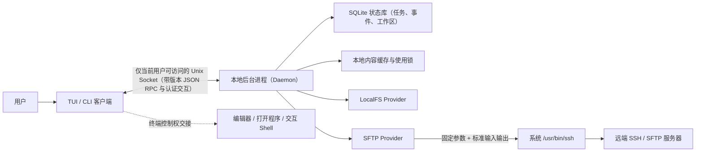
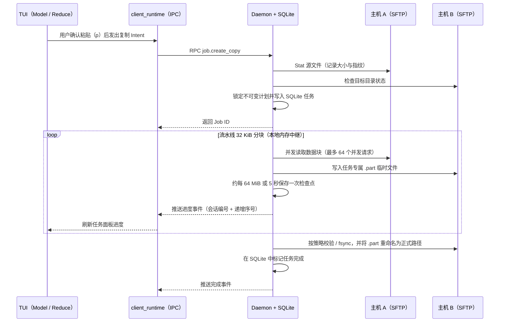

# 整体技术设计与架构

[English](../../architecture/design.md)

AMSFTP 是一款同时操作本地目录和 SFTP 服务器的双栏终端文件管理器。左右任意一栏
都可以指向本机目录或 `~/.ssh/config` 中的 SSH 主机，因此本地到本地、本地到远端、
远端到远端共享同一套交互模型与传输引擎。

本文说明 AMSFTP 的整体架构、一条真实操作如何穿过客户端与后台进程到达远端服务器，
以及安全与可靠性边界所在。

## 1. 决定这套架构的五个核心问题

普通文件浏览器只需要单个交互进程就能跑起来，但一个可靠的 SFTP 传输工具必须解决
五个更棘手的工程问题：

1. **真实世界的 SSH 环境极度复杂：** 用户依赖 `~/.ssh/config`、`Include`、`Match`、
   `ProxyJump`、`ProxyCommand`、SSH Agent、硬件密钥、MFA 交互认证以及
   Kerberos/GSSAPI。在 Go 里重造一套 SSH 协议栈既会长期落后于 OpenSSH，又会逼着
   用户再维护一份凭据。
2. **传输任务必须比终端活得更久：** 合上笔记本、断开 tmux 或直接按 `q` 退出 TUI，
   都不能把正在跑的 10 GiB 上传杀死，更不能让任务结果变成“不知道成功还是失败”。
3. **半成品绝不能伪装成正式文件：** 传到一半断网时，目标路径上不能留着一个截断损坏
   的文件；移动文件时，目标未确认落位前绝不能删除源文件。
4. **远端服务器返回的数据不可信：** SSH 认证通过只证明连上了哪台机器，不代表远端
   文件名、元数据或报错文本可以安全地直接输出到终端或拼进 Shell 命令。
5. **超大目录树不能撑爆内存：** 目录列表、文件预览、递归搜索、传输缓冲、日志和任务
   队列全部需要硬上限，面对海量文件时应优雅降级，而不是耗尽内存把客户端杀掉。

AMSFTP 里的每一道核心边界，都是为了解决这五个问题而设计的。

## 2. 进程模型与整体拓扑

AMSFTP 只发布单个可执行文件（`cmd/amsftp`），在运行时分为两个清晰角色：

- **短生命周期客户端（TUI / CLI）：** 只负责与终端绑定的事情——键盘输入、画面
  渲染、二次确认弹窗，以及把终端临时交给编辑器或交互 Shell。客户端绝不直接向
  远端写数据。
- **每用户本地后台进程（Daemon）：** 持有长期 SSH/SFTP 连接、后台传输任务、
  SQLite 任务与工作区状态，以及本地文件缓存。它严格以当前操作系统用户运行——
  不需要 `root`，也不监听任何 TCP 端口。

### 客户端与 Daemon 通信（IPC）

客户端与 Daemon 之间通过仅当前用户可访问的 Unix Domain Socket 通信（`0700` 目录
内的 `0600` socket）：

- **对端身份校验：** 服务端与客户端双向校验操作系统对端 UID（Linux 上用
  `SO_PEERCRED`，macOS 上用 `LOCAL_PEERCRED`），不匹配直接拒绝。
- **带版本号和消息大小上限的协议：** 握手阶段协商协议版本与特性；JSON 消息设有单条
  大小上限（默认 8 MiB）与请求超时。
- **支持 Daemon 重启的事件流：** Daemon 每次启动都会生成唯一的会话编号（epoch），
  推送的事件带有单调递增序号。如果 Daemon 发生重启，客户端会检测到新会话编号，
  自动重连左右两栏并丢弃旧进程的迟到响应。

把终端交互与后台任务拆开之后，按 `q` 退出 TUI 只是断开前端视图，后台传输继续运行；
崩溃恢复也永远只有 Daemon 这一个责任主体。

### 交互式 SSH 密码 / MFA 提示如何回到终端

因为 `/usr/bin/ssh` 由 Daemon 启动，而终端归 TUI 管理，AMSFTP 用一个纯内存认证代理
（`internal/auth`）把交互提示桥接回终端，全程不落盘：

1. `/usr/bin/ssh` 调用 AMSFTP 内置的 `SSH_ASKPASS` 子角色，向 Daemon 的认证代理
   请求用户输入。
2. 如果当前有 TUI 客户端在线，Daemon 通过 IPC 把提示推给 TUI；用户在终端输入后，
   TUI 直接经 IPC 把答案送回内存。
3. Daemon 把答案交给 OpenSSH 并随即清零内存。如果此时没有 TUI 在线，后台任务会暂停
   在 `waiting_auth` 状态，绝不猜测或保存密码。

## 3. 核心抽象：Endpoint、Provider 与 OpenSSH 委托

### Endpoint 与 Location

**Endpoint** 代表一个文件系统边界（本机 `local` 或某个具体的 SSH 主机别名）；
**Location** 是“Endpoint + 绝对路径”的组合。这样 `host-a` 上的 `/srv/app` 和
`host-b` 上的 `/srv/app` 绝不会被混为一谈。

### 极简 Provider 契约

本地文件与远端 SFTP 主机背后是同一套 `Provider` 接口（`internal/provider`）：

- **只读核心（仅 6 个方法）：** `Descriptor`、`Snapshot`、`Normalize`、`List`、
  `Stat`、`OpenRead`。
- **可选写接口（运行时按需检测）：** 写入、覆盖前备份原文件、回收站删除拆分在独立
  的 Go 接口中（`MutableProvider`、`DestinationPreserver`、`TrashProvider`）。
  执行写操作前，调用方必须同时确认两件事：实现了对应的写接口，并且当前连接的能力清单
  （记录服务器实际支持的 SFTP 扩展，例如原子重命名、`fsync` 等）证实服务端支持所需
  能力。
- **可选预读加速接口：** `ReadAheadHandle` 用于在高延迟 SFTP 链路上并发流水线读取；
  不支持时自动退回普通 `Read`。

每次新建连接都会重新检测服务端能力清单。如果服务端重连后支持的扩展发生变化，AMSFTP
会刷新记录，不会拿旧连接的假设继续跑。

### 为什么把 SSH 完全委托给系统 OpenSSH

SFTP Provider 使用固定的结构化参数直接启动经校验的系统 `/usr/bin/ssh`（强制关闭
端口转发、Agent Forwarding 与 Shell 展开），并通过标准输入输出直接说二进制 SFTP
协议。它**不会**去解析交互式 `sftp` 程序的文本输出，也绝不把主机别名交给 Shell。

因此，`~/.ssh/config`、主机密钥校验、`known_hosts`、SSH Agent、安全密钥、
`ProxyJump` 以及 Kerberos/GSSAPI 的行为与用户直接敲 `/usr/bin/ssh <alias>` 完全
一致。AMSFTP 刻意不内置第二套 SSH 协议栈，也不建自己的凭据库。

### 标准 SFTP 基线与可选增强路径

标准 SFTP 是所有能力的通用基线。两台远端主机之间复制时，数据经由本地 Daemon 内的
小块内存流式转发——按块从主机 A 读出、写入主机 B，既不把整份文件落盘到本地，也不
向任何一台服务器复制 SSH 凭据。

代码里为可选远端辅助程序（`internal/helper`）和服务器间直传
（`internal/directprotocol`）预留了隔离的扩展接口，但在**公开构建中均处于关闭
状态**，且无法通过配置文件开启；增强路径不可用时，所有操作自动停留在标准 SFTP。

## 4. 传输引擎：计划、执行、校验与恢复

无论从 TUI 还是 CLI 发起，每一次复制、移动、重命名或删除都由 Daemon 的传输引擎
统一执行。下面以一次“远端到远端复制”为例，展示完整调用链：

### 执行前锁定不可变计划

在传输第一个字节前，Daemon 会先检查源端与目标端状态，把一份不可变的执行计划写入
SQLite：精确的源/目标位置、初始文件指纹、传输路由、冲突策略、校验模式和落盘同步
策略。Worker 只执行这份已保存的计划；如果文件在执行中途发生实质变化，任务会暂停
等待人工处理冲突，而不是在重试里悄悄改变策略。

### 流水线并发与限速

- **单文件传输：** 标准 SFTP 单文件最多同时发出 64 个未完成的 32 KiB 读写请求，在
  高延迟网络下也能跑满吞吐，同时无需在内存中缓存整个文件。
- **目录并发复制：** 最多 8 个文件共享 128 个并发数据请求名额。小文件按实际大小申请
  窗口；父目录永远先于子文件创建；递归遍历绝不跟随符号链接。
- **定期保存检查点：** 传输进度约每 64 MiB 或 5 秒保存一次检查点（记录已确认偏移量、
  源端增量 SHA-256 状态以及临时文件身份），避免每个数据包都被磁盘同步卡死。
- **带宽限速：** 支持全局、单主机与单任务三级字节限速，且等待带宽期间随时可被暂停
  或取消打断。

### 校验与落盘同步的权衡

内容校验与文件同步是两个独立开关，让日常复制足够快，同时让移动与编辑保持最严格保护：

| 模式 | 检查内容 | 额外 I/O 成本 |
| --- | --- | --- |
| **普通复制默认**（`protocol` + `none`） | 所有 SFTP 写入获服务端确认、字节数一致、文件正常关闭、临时文件重命名成功 | 极低（接近原生 `sftp`，并多了临时文件防残缺保护） |
| **严格摘要校验**（`verification: "sha256"`） | 回读临时文件与正式文件并核对源端 SHA-256 | 上传额外增加 2 倍读 I/O |
| **完成时落盘同步**（`durability: "completion"`） | 关闭重命名前调用一次 `fsync`（类似 `sftp put -f`） | 每文件增加 1 次 `fsync` 往返 |
| **移动与远端编辑回写** | 始终保留 SHA-256 校验与检查点同步 | 更高 I/O，换取最高数据安全性 |

**诚实的协议边界：** SSH 加密只保护网络传输中的字节，不验证远端磁盘上实际落盘的
内容；一次 `fsync` 成功只是文件数据同步的依据，不能保证底层存储硬件诚实可靠。在
不支持原子条件重命名扩展的 SFTP 服务器上，检查与重命名之间依然存在并发窗口——
AMSFTP 会在校验阶段尽量发现异常，但无法把 SFTP 变成分布式事务数据库。

### 错误模型与崩溃恢复

内部错误统一封装为 `domain.OpError`，明确携带三个维度：

- **`Code`：** 稳定错误分类（如 `conflict`、`auth_required`、
  `transport_interrupted`、`resource_exhausted` 等）。
- **`Retry`：** 明确重试建议（`never`、`backoff`、`after_reconnect`、
  `after_auth`、`after_conflict`、`after_replan`）。
- **`Effect`：** 副作用状态（`none` 未生效、`applied` 已生效、`unknown` 未知）。

把“是否已产生副作用”显式化，就能防止对非幂等步骤盲目重试。在进程重启或断点续传时：

1. **临时文件续传：** 因为检查点约每 64 MiB 或 5 秒才落盘一次，意外崩溃后临时文件
   末尾可能多出尚未记入检查点的尾部字节。恢复时，即使文件大小和修改时间看起来一致，
   AMSFTP 仍会对已保存前缀做哈希校验并比对源端摘要；多出的尾部字节必须先与未变化
   的源文件逐段核对一致，才截断回退到检查点。无法证明一致的临时文件会被保留并报
   冲突，绝不静默追加或丢弃数据。
2. **重命名响应丢失：** 如果在最后一步重命名时断网，即使处于默认 `protocol` 模式，
   恢复时也必须通过全量内容校验确认目标一致后才能宣称成功。
3. **移动操作：** 只有在目标校验并正式重命名到位之后才会删除源文件；若无法确认删除
   成功，源文件会被保留，任务标记为“已完成但保留源文件”。

## 5. 交互层：TUI、预览、远程编辑与搜索

### 纯函数式 Model/Reducer TUI

`internal/tui` 采用 Elm 风格的纯函数架构：

- `Model` 是纯数据结构，`Reduce(Model, Action) -> (Model, []Intent)` 是纯状态
  转移函数，`Render` 将画面绘制到内存画布上。
- `internal/tui` 内部**零 I/O**（不碰文件、网络或子进程）。
- `internal/app/client_runtime.go` 负责解释 `Intent`，异步调用 Daemon RPC 再把
  结果作为 `Action` 送回状态机。
- 每次目录加载、预览和搜索请求都带有递增的请求版本号（每次切目录或新搜索时加 1），
  旧请求迟到的结果会被直接丢弃。
- 渲染只计算当前终端可见行窗口，不会为目录里的上万条目逐一构建界面行。

### 预览与本地内容缓存

- **预览（`internal/preview`）：** 只按需读取小范围字节（不加载整个大文件）；转义
  终端控制字符防止终端注入攻击；符号链接只显示元数据；仅在终端主动证实支持图片协议
  后才输出图片转义序列。
- **本地缓存（`internal/cache`、`internal/cachefs`、`internal/cachemanager`）：**
  按内容 SHA-256 寻址存储预览与编辑副本，与传输 `.part` 文件及任务库完全隔离。
  默认配额为全局 2 GiB、单工作区 1 GiB。正在被预览、编辑器、外部打开程序或待恢复
  会话使用的文件持有使用锁（代码称缓存租约 `lease`），防止编辑或预览中途文件被自动
  清理。

### 安全的远端编辑闭环

用终端编辑器编辑远端文件（`e`）或用桌面应用打开（`o`）时，AMSFTP 绝不会因为进程
退出或修改时间变化就偷偷覆盖服务器：

1. 下载并校验本地副本到缓存，同时加使用锁防止自动清理误删。
2. 干净交接终端前台控制权（`internal/terminalhandoff`），通过 `exec` 直接拉起
   编辑器（不经 Shell）。
3. 编辑器退出后（或桌面应用由用户按 `Enter` 触发检查），执行三方比对：打开时的原始
   版本 vs 本地修改 vs 远端当前文件。
4. 仅在用户明确确认后发起上传；覆盖前先在同目录保存一份远端原文件的隐藏备份。

### 带资源上限的递归搜索

文件名搜索（`f`）与内容搜索（`g/`）对目录深度、遍历条目数、读取文件数、扫描字节数、
总耗时和结果数都设有硬上限。任一上限触发即立刻返回已找到的匹配并明确标注为**部分
结果**，既不卡死客户端，也不伪装成完整答案。

## 6. 持久化存储、升级与诊断

### SQLite 状态库与受控迁移

`internal/state` 与 `internal/statefs` 用 SQLite 持久化任务、事件流水、检查点、
编辑恢复记录和工作区索引。表结构采用严格类型与 `CHECK` 约束，确保即便代码出 bug
也写不进非法任务状态。Schema 升级坚持先备份、升级后执行完整性检查（`quick_check`、
`foreign_key_check`），并对 WAL 大小设上限。一旦状态不确定，启动会安全停止或进入
只读模式，绝不自动删库重建。

### 安全自升级

`internal/selfupdate` 通过独占私有升级锁避免多个升级进程或旧客户端抢着拉起旧
Daemon。有活跃传输任务时拒绝升级；替换程序后必须确认新二进制与新 Daemon 版本一致
才报告成功。

### 脱敏错误与诊断支持包

`OpError.Error()` 默认不输出底层原始错误（跨 IPC 前显式剥离 `Cause`）。持久日志
采用字段白名单，不记录原始路径、命令参数、环境变量、文件内容或认证信息。`doctor`
严格只读；`support-bundle` 必须先预览再凭匹配的 SHA-256 确认摘要生成新的本地私有
压缩包，绝不自动上传。

## 7. 安全模型与信任边界

AMSFTP 为每项安全责任指定单一明确的主体：OpenSSH 负责 SSH 信任与认证，本地
Daemon 负责持久化文件操作，用户负责确认所有破坏性动作与外部程序执行。

### 信任边界

| 边界 | 信任内容 | 持续校验内容 |
| --- | --- | --- |
| 本地操作系统账号 | 已登录用户主动运行 AMSFTP | 环境变量、配置 Schema、终端输入、目录属主/权限/ACL/符号链接 |
| 客户端 ↔ Daemon IPC | 通过同用户 UID 与协议握手后的对端 | 消息大小、请求 ID、协议版本、超时与消息结构 |
| 系统 OpenSSH | 经校验的 `/usr/bin/ssh` 及其安全策略 | 可执行路径、固定参数列表、进程生命周期、限长 stderr（防止刷屏撑爆内存） |
| 远端 SSH/SFTP 服务器 | 符合 OpenSSH 策略的主机身份；默认模式下的写/关/重命名确认 | 文件名、元数据、大小、服务端扩展与错误；SHA-256 模式下独立校验目标内容 |
| 编辑器 / 打开程序 / Shell | 仅限用户明确配置或输入的程序与命令 | 直接 `exec` 参数（禁 Shell 拼接）、回写前三方比对 |
| 已安装发行包 | 经 Homebrew 或官方 SHA-256 校验的字节 | 安装目录属主、权限、无符号链接与版本一致性 |

### 核心安全措施

- **零凭据落盘：** 密码、私钥、SSH Agent 内容、Kerberos 票据与交互认证答案绝不进入
  配置、SQLite、工作区、日志、缓存元数据或支持包；交互答案仅在当次认证内存中存活。
- **远端数据一律视作不可信输入：** 原始路径字节与界面展示文本分离；渲染前转义终端
  控制序列；文件名永不拼入 Shell 命令；外部编辑器与预览器以清洗后的环境变量（剔除
  `LD_PRELOAD`、`SSH_ASKPASS`、`AMSFTP_*`）直接 `exec` 启动。
- **私有目录宁可拒绝也不放宽权限：** 配置、状态库、缓存、日志、socket 与升级锁强制
  校验仅当前用户可访问（`0700`/`0600`、无符号链接、无不安全的组/其他用户写权限或
  ACL）；不满足条件直接拒绝，绝不靠放宽权限“自动修复”。

### 安全模型的明确边界

AMSFTP **不承诺**抵御以下场景：

- 已被攻破的本地操作系统账号、`root`、内核、终端模拟器、OpenSSH 可执行文件，或用户
  自行配置的恶意编辑器/打开程序。（私有 socket 与 `0700` 目录防止同机其他用户访问
  与意外共享，并不能把 AMSFTP 与同一用户的其他进程隔离开。）
- 已被入侵的远端服务器返回虚假文件内容或发起拒绝服务。
- 用户主动确认了错误的删除/覆盖操作，或在 `!` / `gs` 交互 Shell 中执行危险命令。
- 尚未签名/公证的 macOS 预览构建（SHA-256 只证明下载字节与发布页一致，不等同于
  Apple 代码签名或公证）。

## 8. 代码目录映射

| 目录 | 职责 |
| --- | --- |
| `cmd/amsftp` | 单一可执行文件入口与构建元数据 |
| `internal/app` | CLI 子命令、客户端事件循环（`client_runtime.go`）、Daemon 启动组装、编辑/预览编排 |
| `internal/tui`、`internal/keymap` | 纯函数 Model/Reducer（`reducer.go`、`reducer_keys.go`）、窗口化渲染、键位校验 |
| `internal/daemon`、`internal/ipc` | 每用户后台进程生命周期、RPC 路由、带版本号和消息大小上限的 Unix Socket 协议 |
| `internal/domain`、`internal/job` | 核心领域类型（`Endpoint`、`Location`、服务端能力、`OpError`）与任务状态机 |
| `internal/provider`（`localfs`、`sftp`、`fake`、`contracttest`） | 读写 Provider 接口规范、本地与 SFTP 实现、共享契约测试集 |
| `internal/transfer` | 计划锁定、路由、流水线 Worker、校验、重命名落位、恢复与限速调度器 |
| `internal/state`、`internal/statefs` | SQLite 存储（`jobstore`、`cachestore`、`editstore`）、受控迁移与 WAL 大小上限保护 |
| `internal/cache`、`internal/cachefs`、`internal/cachemanager` | SHA-256 内容寻址本地缓存、配额、使用锁（缓存租约）与进程存活检查 |
| `internal/preview`、`internal/edit`、`internal/search` | 分段预览与控制字符转义、三方远端编辑状态机、带上限文件名/内容搜索 |
| `internal/transport/openssh`、`internal/sshconfig`、`internal/auth` | 系统 `/usr/bin/ssh` 边界、`~/.ssh/config` 解析、内存交互认证代理 |
| `internal/platform`、`internal/externalprocess`、`internal/terminalhandoff` | 平台私有路径/socket/ACL 校验、安全 `exec` 启动器、TTY 前台交接 |
| `internal/config`、`internal/workspace`、`internal/diagnostic`、`internal/supportbundle`、`internal/selfupdate` | 严格配置 Schema、工作区、白名单日志、两步支持包、安全自升级 |
| `internal/helper`、`internal/directprotocol` | 可选远端加速与直传边界（公开构建中保持关闭） |

## 9. 核心架构红线

后续任何新功能或性能优化都必须守住这九条底线：

1. 系统 OpenSSH 是 SSH 配置、认证与主机密钥的唯一事实来源，不新增应用内凭据库。
2. 密钥、密码、票据和认证答案绝不进入配置、SQLite、工作区、日志或支持包。
3. 客户端不直接修改 Provider；所有写操作先锁定不可变计划，再交由 Daemon 和传输引擎
   执行。
4. 未完成的传输内容绝不暴露在最终路径；移动操作在目标校验并重命名到位前绝不删除源
   文件。
5. 重试与崩溃恢复只跨越可安全重复的步骤，或先核对远端实际状态再继续的步骤。
6. 列表、预览、搜索、传输缓冲、缓存、日志与事件队列全部保持严格上限。
7. 私有目录、文件与 Unix Socket 必须通过属主、权限、符号链接与对端 UID 校验，绝不
   静默放宽权限或跳过检查。
8. 暴露给界面、JSON 与日志的错误只包含安全字段，绝不透出原始底层错误、命令或凭据。
9. 可选远端增强在公开构建中保持关闭，且任何异常都必须安全回退到标准 SFTP。

## 10. 性能基准测试（面向开发者）

仓库内置两组按需运行的 Linux 基准测试，用真实 Worker、SQLite 日志和 SFTP Provider
与系统原生 `sftp` 客户端做工程上的相对性能对比（不代表广域网吞吐承诺）：

- **`make bench-transfer`：** 依赖 Python 3 与 OpenSSH SFTP Server，通过本地延迟代理
  （0 / 20 / 80 / 200 ms）对照上传、下载、中继、小文件目录与限速场景
  （`AMSFTP_PERFORMANCE_OUT` 指定结果输出目录）。
- **`make bench-transfer-ssh`：** 通过真实本机回环 TCP、OpenSSH 加密与私有 `sshd`
  测试环境，重复对照 256 MiB 上传/下载在默认模式、完成时同步和 SHA-256 模式下的表现，
  不修改用户 SSH 配置（`AMSFTP_PERFORMANCE_OPENSSH_DIR` 可指定同版本 `ssh`/`sftp`
  目录）。
